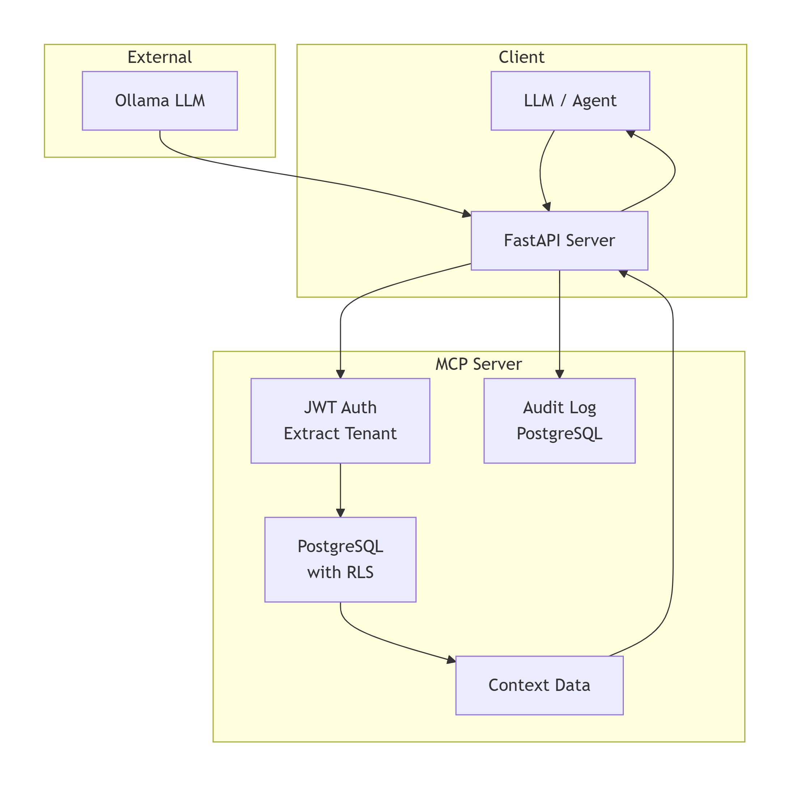
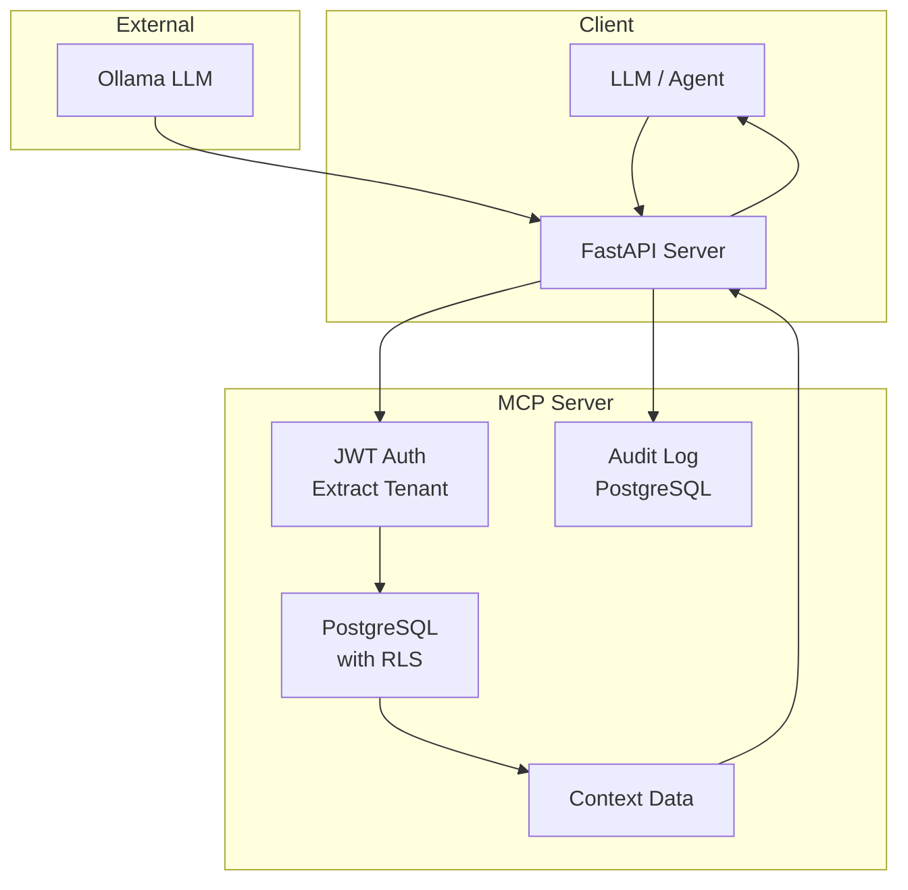

# Model Context Protocol (MCP) Server

A secure, multi‑tenant server that provides context to LLMs using an MCP-inspired protocol. Features JWT authentication, row‑level security (RLS), and audit logging.

---

## Table of Contents
- [Overview](#overview)
- [Architecture](#architecture)
- [Features](#features)
- [Tech Stack](#tech-stack)
- [Prerequisites](#prerequisites)
- [Setup & Installation](#setup--installation)
- [Running the Server](#running-the-server)
- [API Endpoints](#api-endpoints)
- [Testing with LLM](#testing-with-llm)
- [Security Considerations](#security-considerations)
- [Audit Logs](#audit-logs)
- [Troubleshooting](#troubleshooting)
- [Next Steps](#next-steps)

---

## Overview

This project demonstrates a **secure context server** that can be integrated with LLMs (like Ollama) to provide real‑time, tenant‑specific data. It mimics the Model Context Protocol (MCP) concept, where an LLM requests context from backend systems in a safe, auditable way.

**Key aspects**:
- **Authentication**: JWT tokens identify the tenant.
- **Authorization**: PostgreSQL RLS ensures tenants only see their own data.
- **Audit**: Every context request is logged.
- **Simplicity**: The server is API‑only; the LLM can call it via a tool.

---

## Architecture





*To generate a PNG image, copy the Mermaid code into [mermaid.live](https://mermaid.live) and export as PNG.*

---

## Features

- **JWT Authentication**: Tokens contain `tenant_id` claim.
- **Multi‑Tenant Data**: Each tenant sees only their own orders and users.
- **Row‑Level Security**: PostgreSQL RLS enforces tenant isolation.
- **Audit Logging**: All context requests are logged with timestamp, tenant, and endpoint.
- **Sample Data**: Pre‑loaded synthetic customers and orders for tenants `tenant_a` and `tenant_b`.
- **LLM Integration Example**: Script shows how an LLM (via Ollama) can call the context server.

---

## Tech Stack

| Component          | Technology                    |
|--------------------|-------------------------------|
| **Server**         | Python + FastAPI              |
| **Database**       | PostgreSQL with RLS           |
| **Authentication** | JWT (PyJWT)                   |
| **Audit**          | Custom PostgreSQL table       |
| **Container**      | Docker Compose                |

---

## Prerequisites

- Python 3.10+
- Docker and Docker Compose
- Ollama (optional, for testing LLM integration)

---

## Setup & Installation

### 1. Clone the Repository
```bash
git clone https://github.com/your-username/mcp-context-server.git
cd mcp-context-server
```

### 2. Create Virtual Environment
```bash
python -m venv venv
source venv/bin/activate  # On Windows: venv\Scripts\activate
```

### 3. Install Dependencies
```bash
pip install -r requirements.txt
```

### 4. Start PostgreSQL
```bash
docker-compose up -d
```

### 5. Configure Environment
Copy `.env.example` to `.env` and edit if needed (defaults are fine for local).

### 6. Initialize Database
```bash
python scripts/init_db.py
```
This creates tables, enables RLS, inserts sample tenants and data.

### 7. Generate Test Tokens
```bash
python scripts/generate_token.py --tenant tenant_a
```
Copy the token output. You'll use it in API requests.

---

## Running the Server

Start the FastAPI server:
```bash
uvicorn src.context_service:app --reload --port 8000
```

The API will be available at `http://localhost:8000`.

---

## API Endpoints

### `GET /health`
Health check.

### `GET /context/orders`
Returns orders for the authenticated tenant.

**Headers**:
```
Authorization: Bearer <JWT>
```

**Response** (example):
```json
[
  {"id": 1, "customer_name": "Alice", "total": 1200.0},
  {"id": 2, "customer_name": "Bob", "total": 850.0}
]
```

### `GET /context/customers`
Returns customers for the authenticated tenant.

### Audit Logs
All requests are logged in the `audit_logs` table. You can inspect them:
```sql
psql -h localhost -U postgres -d mcp_db -c "SELECT * FROM audit_logs ORDER BY timestamp DESC LIMIT 5;"
```

---

## Testing with LLM

You can test how an LLM (like Ollama) can call this context server. Example script:

```python
# example_llm_call.py
import requests
import json

JWT = "your_generated_token"
API_URL = "http://localhost:8000/context/orders"

response = requests.get(
    API_URL,
    headers={"Authorization": f"Bearer {JWT}"}
)
orders = response.json()
print("Orders:", orders)

# Now feed this context into an LLM (e.g., via Ollama)
context = f"Orders: {json.dumps(orders)}"
# Call Ollama with a prompt using the context...
```

You can extend this to a full agent that decides which endpoint to call based on the user's question.

---

## Security Considerations

- **JWT secret**: Store securely, use a strong key.
- **PostgreSQL RLS**: Ensures even if a tenant obtains another tenant's JWT (unlikely with proper signing), they can't access other data.
- **Audit**: Logs all requests for compliance.
- **TLS**: In production, use HTTPS.

---

## Audit Logs

All context requests are logged in the `audit_logs` table with:
- `timestamp`
- `tenant_id`
- `endpoint`
- `user_id` (optional, can be extended)

To view recent logs:
```bash
psql -h localhost -U postgres -d mcp_db -c "SELECT * FROM audit_logs ORDER BY timestamp DESC LIMIT 10;"
```

---

## Troubleshooting

| Problem | Solution |
|---------|----------|
| Token invalid | Check the JWT secret in `.env` matches the one used in generation. |
| No data returned | Verify the tenant ID in the token exists in the `tenants` table. |
| RLS errors | Ensure you enabled RLS on tables and created policies correctly (the init script does this). |
| PostgreSQL connection refused | Check `docker-compose ps`; ensure container is running. |

---

## Next Steps

- Add more context endpoints (e.g., `GET /context/user/{id}`).
- Integrate with LangChain as a custom tool.
- Deploy to cloud with managed PostgreSQL.
- Add rate limiting and request throttling.

---

## License

MIT
.
.
.
.
.
